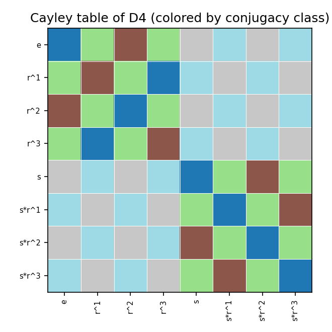
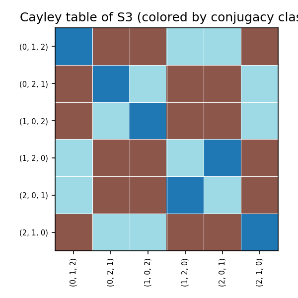
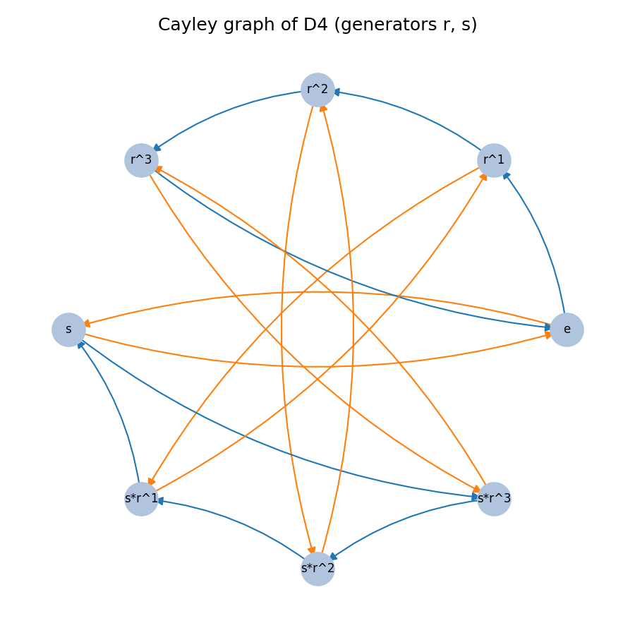
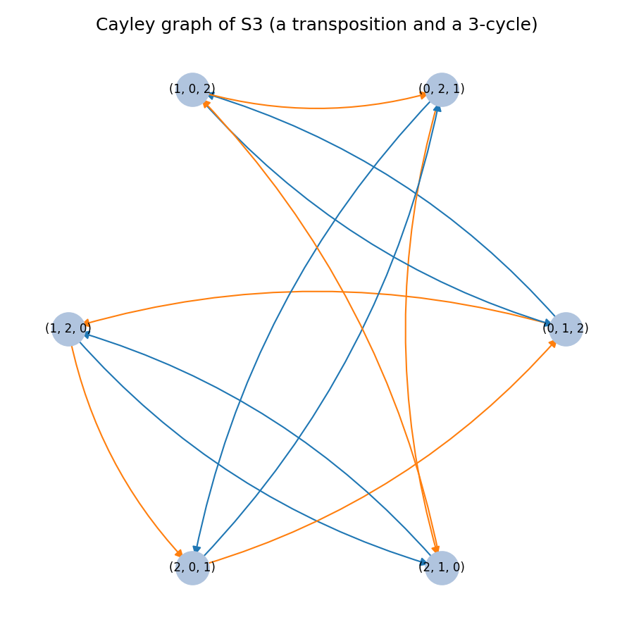

# Finite Group Toolkit

A small library for working with finite groups given by their Cayley (multiplication) table:
axiom validation, subgroups, cosets, normality, conjugacy classes, quotient groups, and a
brute-force isomorphism test — plus constructors for the standard families (cyclic, dihedral,
symmetric groups).

## Installation

```bash
cd group-toolkit
pip install -e .          # core library
pip install -e ".[viz]"   # adds matplotlib + networkx, needed for the two visualization demos
pytest tests/            # 21 tests
```

## Core idea

A finite group is fully described by its Cayley table: an $n \times n$ array where entry
$(i,j)$ gives the product of element $i$ and element $j$. `FiniteGroup` takes such a table and
validates, on construction, that it actually defines a group:

- **closure** — automatic, since every table entry is a valid element index
- **identity** — searches for $e$ with $e \cdot x = x \cdot e = x$ for all $x$
- **inverses** — every element has some $y$ with $x \cdot y = y \cdot x = e$
- **associativity** — checked directly over all $n^3$ triples

A malformed table (missing identity, missing inverses, or a non-associative operation) raises
`GroupAxiomError` rather than silently producing wrong answers later.

```python
from group_toolkit import FiniteGroup

table = [[0, 1, 2], [1, 2, 0], [2, 0, 1]]   # Z/3Z
g = FiniteGroup(table)
```

## What's implemented

- **Subgroups**: `generate_subgroup(generators)` (closure of a generating set),
  `all_subgroups()` (found by closing pairs of known subgroups until no new one appears),
  `is_subgroup(subset)`
- **Cosets**: `left_coset` / `right_coset` / `left_cosets`
- **Normality**: `is_normal(subgroup)` — compares left and right cosets
- **Conjugacy**: `conjugate`, `conjugacy_class`, `conjugacy_classes`, `center()`
- **Quotient groups**: `quotient_group(normal_subgroup)` — builds the Cayley table on cosets
- **Isomorphism**: `is_isomorphic(G1, G2)` — brute-force search over bijections fixing the
  identity, checking the homomorphism property; practical for the small groups this project
  works with (order $\lesssim 8$, i.e. up to $7! = 5040$ candidate maps)

## Constructions

```python
from group_toolkit import cyclic_group, dihedral_group, symmetric_group, direct_product, klein_four_group

cyclic_group(6)        # Z/6Z
dihedral_group(4)      # D4, order 8: symmetries of a square
symmetric_group(3)     # S3, order 6: all permutations of {0,1,2}
direct_product(cyclic_group(2), cyclic_group(2))   # = klein_four_group()
```

## Results verified against standard theory

`examples/explore_subgroup_structure.py` and `tests/test_group.py` check the toolkit's output
against known facts, rather than just checking the code runs:

- **$S_3$ has exactly 6 subgroups**: trivial, three of order 2, one of order 3 ($A_3$), and
  $S_3$ itself — matching the textbook subgroup lattice.
- **$A_3 \trianglelefteq S_3$** (index 2, normal), but none of the order-2 subgroups are normal.
- **$S_3$'s conjugacy classes** have sizes $1, 2, 3$ (identity, 3-cycles, transpositions).
- **$D_4 / Z(D_4) \cong V_4$** (the Klein four-group) — a standard but genuinely nontrivial
  fact, checked here via the quotient construction plus the isomorphism test, not asserted.
- **$S_3 \cong D_3$** — the two different-looking constructions of "the" non-abelian group of
  order 6 are confirmed isomorphic by direct search.

```python
from group_toolkit import dihedral_group, klein_four_group, is_isomorphic

d4 = dihedral_group(4)
q = d4.quotient_group(d4.center())
print(is_isomorphic(q, klein_four_group()))   # True
```

## Semidirect products

`semidirect_product(G, H, action)` builds $G \rtimes_\phi H$ from an action $\phi: H \to \mathrm{Aut}(G)$, supplied as a list of permutations (one automorphism of $G$ per element of $H$). The action is validated before building the table: each $\phi(h)$ must be a genuine automorphism of $G$ (a bijection respecting multiplication), and $h \mapsto \phi(h)$ must itself be a homomorphism $H \to \mathrm{Aut}(G)$. A malformed action raises `GroupAxiomError`, same as a malformed Cayley table.

The standard example: $D_n \cong \mathbb{Z}_n \rtimes \mathbb{Z}_2$, where the nontrivial element of $\mathbb{Z}_2$ acts on $\mathbb{Z}_n$ by inversion ($g \mapsto -g$). `inversion_action(n)` builds exactly this action:

```python
from group_toolkit import cyclic_group, dihedral_group, semidirect_product, inversion_action, is_isomorphic

zn, z2 = cyclic_group(5), cyclic_group(2)
semi = semidirect_product(zn, z2, inversion_action(5))
print(is_isomorphic(semi, dihedral_group(5)))   # True
```

`examples/semidirect_demo.py` confirms this for several $n$.

## Sylow subgroup search

`sylow_subgroups(group, p)` finds every Sylow $p$-subgroup — a subgroup whose order is the largest power of $p$ dividing $|G|$ — by filtering `all_subgroups()`, since that already enumerates every subgroup; no separate search algorithm is needed. `sylow_summary(group, p)` additionally checks the results against Sylow's theorems: the count $n_p$ satisfies $n_p \equiv 1 \pmod p$ and $n_p \mid |G|/p^k$, and all Sylow $p$-subgroups are conjugate to one another.

Checked against $S_4$ (order $24 = 2^3 \cdot 3$), where the textbook answer is $n_2 = 3$ and $n_3 = 4$:

```python
from group_toolkit import symmetric_group
from group_toolkit.sylow import sylow_subgroups

s4 = symmetric_group(4)
print(len(sylow_subgroups(s4, 2)))   # 3
print(len(sylow_subgroups(s4, 3)))   # 4
```

`examples/sylow_demo.py` runs this and prints the full Sylow-theorem checks.

## Cayley table heatmap

`draw_cayley_table(group, filename)` renders the multiplication table as a heatmap, coloring each cell by the conjugacy class of the product $a \cdot b$ — so conjugacy classes appear as visible colored regions rather than as a list of numbers.

**$D_4$:**



**$S_3$:**



## Cayley graph visualization

`examples/cayley_graph_demo.py` draws the Cayley graph of a group with respect to a chosen
generating set (vertices = elements, an edge $g \to g s$ for each generator $s$, colored by
generator) using `networkx` + `matplotlib`.

**$D_4$**, generated by a rotation $r$ and a reflection $s$:



**$S_3$**, generated by a transposition and a 3-cycle:



## Project layout

```
group-toolkit/
├── pyproject.toml
├── conftest.py
├── src/group_toolkit/
│   ├── __init__.py
│   ├── group.py             (FiniteGroup, GroupAxiomError, is_isomorphic)
│   ├── constructions.py     (cyclic_group, dihedral_group, symmetric_group, ...)
│   ├── semidirect.py        (semidirect_product, inversion_action)
│   ├── sylow.py             (sylow_subgroups, sylow_summary, p_part)
│   └── visualize.py         (draw_cayley_table)
├── examples/
│   ├── explore_subgroup_structure.py
│   ├── cayley_graph_demo.py
│   ├── cayley_table_heatmap_demo.py
│   ├── semidirect_demo.py
│   └── sylow_demo.py
├── assets/                  (checked-in example output)
└── tests/
```

## Known limitations

- `all_subgroups()` uses a closure-of-pairs search, not a principled algorithm (e.g. via
  Sylow theory); it is fine for the small groups this project targets but would not scale to
  groups with hundreds of subgroups. `sylow_subgroups()` is built directly on top of it, so
  it inherits the same practical size limit.
- `is_isomorphic` is $O(n!)$ in the worst case (it searches over bijections of the
  non-identity elements); usable up to around order 8–9, not designed for larger groups. The
  test suite and examples respect this: `semidirect_demo.py` and the corresponding tests use
  the full isomorphism check only for small $n$, and fall back to comparing structural
  invariants (order, abelian-ness, the multiset of element orders) for larger cases.
- Associativity checking is $O(n^3)$, which is the only place table validation could get slow
  for large $n$; every construction here (cyclic, dihedral, symmetric) stays well within a
  practical range.
- `semidirect_product` validates that the supplied action is a genuine homomorphism into
  $\mathrm{Aut}(G)$, but does not search for or enumerate valid actions itself — the caller
  has to supply one (as `inversion_action` does for the dihedral case).

